# Diccionario del schema objetivo — Core y Dentistry

Fecha inicial: 2026-10-21. Actualización: 2026-10-23. Versión del documento: 0.8.

Estado: schema objetivo implementado en packages/db, contrato y tipos regenerados; aplicado a QA el 23/10/2026 mediante `20261023T1300_target_schema`. El ensayo con rollback, las reglas de datos aprobadas y la verificación estricta están en [target-schema-migration.md](target-schema-migration.md). Los endpoints existentes de ambos backends están adaptados localmente, con cambios mínimos de tipos de transporte en Dentistry frontend. Los flujos nuevos del plan base siguen pendientes conforme al alcance confirmado. Véanse el [registro del schema](target-schema-implementation.md) y la [adaptación de backends](backend-schema-adaptation.md) para sus entregas originales. Las decisiones acordadas se distinguen de las propuestas técnicas y de los puntos pendientes.

**Condición de ejecución actualizada:** el usuario confirmó que el proyecto ya funciona en QA y debe conservar ese comportamiento; hay seis horas de mantenimiento y los únicos consumidores están en este repositorio. El [plan de estandarización](semantic-standardization-plan.md) separa la entrega nominal de retiros de columnas, cambios de tipos, reglas y funcionalidades. Este diccionario sigue siendo el objetivo de producto; no es la lista de cambios que deba aplicarse completa durante el refactor nominal. En particular, los 14 retiros propuestos quedan diferidos y la semántica actual de acceso de planes se conserva durante esa entrega.

Después de completar la entrega nominal, el usuario autorizó expresamente implementar el schema completo del diccionario, incluidos retiros y tipos, antes de adaptar los backends. Esa implementación local es incompatible con los backends anteriores y no autoriza aplicar el borrador de migración ni resetear QA. Las reglas de acceso y los puntos pendientes siguen requiriendo implementación de aplicación.

Fuentes: `packages/db/src/prisma/schema.ts`, contrato generado, repositorios y entidades de Core/Dentistry, configuración de planes, pantallas de pacientes/agenda/historial y decisiones de la conversación. El 23/10 se inspeccionaron metadatos y datos agregados de QA, se ensayó la migración con rollback y se verificó su aplicación; no se exportaron datos personales ni textos clínicos.

## 1. Alcance y leyenda

La versión 0.1 prioriza filiación, antecedentes fijos, agenda interna, citas y registro narrativo de atenciones/procedimientos. Incluye una sucursal, dos odontólogos —propietario y empleado— y hasta 300 pacientes por organización. Inventario y soporte son secundarios. Tratamientos, odontograma y archivos pertenecen al siguiente alcance; la prueba de esas funciones solo podrá activarse cuando estén implementadas.

Decisión confirmada: el empleado consulta solo pacientes asignados explícitamente y sus historias clínicas. Un mismo paciente puede tener varios odontólogos autorizados, con un único expediente institucional. Esto añade PatientPractitionerAssignment al diseño funcional; no se deduce autorización de createdByMembershipId, citas o atenciones.

Alta y asignación confirmadas: propietario y empleado pueden registrar pacientes nuevos. El empleado solo puede asignarse a sí mismo durante esa alta; para obtener acceso a un paciente existente debe asignarlo el propietario. El propietario puede asignarse y asignar a otros odontólogos de la organización.

Sucursales confirmadas: un Patient pertenece a una sola Organization y puede vincularse con varias Branch de esa misma organización mediante PatientBranchAssignment. No se comparte una identidad ni expediente entre organizaciones independientes. El vínculo a sucursal y la asignación a odontólogo representan relaciones diferentes y no se sustituyen.

| Marca | Significado |
|---|---|
| C — Conserva | Mantiene nombre y significado. Puede recibir restricciones generales de integridad. |
| R — Renombra | Cambia identificador, manteniendo el concepto. Se muestra `actual → objetivo`. |
| M — Modifica | Cambia tipo, obligatoriedad, regla o significado. También identifica retiros explícitos. |
| A — Añade | No existe en el contrato actual. |
| R+M | Renombra y además precisa comportamiento o restricciones. |
| P | Decisión pendiente; no debe implementarse como si estuviera aprobada. |

Un campo retirado se marca **M — retirar**. No desaparece silenciosamente del inventario. Los cambios de este documento son objetivo de diseño, no un registro de cambios ejecutados.

### Convenciones acordadas

- Schemas: `core` y `dentistry`, en minúsculas. `public` sigue reservado al framework.
- Modelo y tabla física: inglés, singular, PascalCase; por ejemplo `dentistry."ClinicalEncounter"`.
- Propiedades y columnas físicas: inglés, camelCase; por ejemplo `"practitionerMembershipId"`.
- Estados y códigos enumerados: mayúsculas. Se unifica `CANCELED`, `canceledAt` y `canceledByMembershipId`.
- Identificadores: UUID con generación UUIDv7 para entidades nuevas. `membershipId` y los sufijos `MembershipId` referencian `core."OrganizationMembership"`, no un usuario global.
- Fecha civil: `DATE` y sufijo `Date`. Instante: `TIMESTAMPTZ` y sufijo `At`, presentado usando la zona IANA de la sucursal/organización.
- Importes: enteros en unidades monetarias menores, sufijo `Minor`, acompañados por `currency`. Ejemplo: `3000` y `BOB` representan Bs 30,00.
- Unidades explícitas: `durationMinutes`, `sizeBytes`, `durationDays`.
- `isActive`: habilitación operativa donde corresponda. `deletedAt`: borrado lógico. `status`: ciclo propio de la entidad. No son sinónimos.
- Campos opcionales: SQL `NULL`; una cadena vacía no representa una respuesta clínica negativa.
- Cada JSON tiene contrato de aplicación con `schemaVersion`; no se usa como depósito de campos arbitrarios.
- Sin FK físicas entre Core y Dentistry, conforme a la arquitectura actual. Se valida pertenencia y vigencia desde la API. Dentro de cada schema se usan FK físicas.

### Tipos y campos comunes

En las tablas siguientes, `?` significa nullable. Los tipos son el objetivo físico; se deberá verificar su expresión concreta en Prisma Next durante la implementación.

| Campo | Tipo | Marca | Definición |
|---|---|---|---|
| `id` | UUID, PK | C | Identidad estable de una entidad; no se modifica al cambiar de plan. |
| `createdAt` | TIMESTAMPTZ | M | Instante de creación; conservar significado y normalizar almacenamiento temporal. |
| `updatedAt` | TIMESTAMPTZ | M | Última modificación; no sustituye un historial de auditoría. |
| `deleted` | boolean actual | M — retirar | Eliminar la duplicación con `deletedAt` tras reconciliar los datos existentes. |
| `deletedAt` | TIMESTAMPTZ? | C | Única fuente del borrado lógico donde ya existe. No añadirlo indiscriminadamente a todas las tablas. |
| `createdByMembershipId` | UUID | C | Membresía del autor de la creación en Dentistry, obtenida de la sesión. |
| `updatedByMembershipId` | UUID? | C | Membresía del último autor de una modificación en Dentistry. |
| `organizationId` | UUID | C | Organización propietaria del registro, no organización elegida libremente en el body. |

La fila `Campos comunes` de cada entidad enumera exactamente cuáles aplica. Los atributos comunes conservan su nulabilidad actual salvo indicación expresa. `deleted` se retira de todas las entidades que lo contienen; los registros clínicos finalizados se corrigen con auditoría, no con eliminación física.

## 2. Inventario completo de tablas

La línea base de QA tras la estandarización declara **14 modelos Core y 11 Dentistry**. El contrato objetivo local ya declara **15 Core y 14 Dentistry**, con cuatro tablas nuevas: vínculo de pacientes con sucursales, asignación explícita de pacientes a odontólogos, política de agenda y prueba de funciones. El total es 29 tablas; las cuatro ampliaciones todavía no se crearon en PostgreSQL. Las tres primeras corresponden a la base clínica y agenda; la prueba de funciones se habilitará cuando sus módulos estén implementados.

Las columnas de nombres actuales de la tabla siguiente conservan la línea base anterior a la estandarización. Sus renombres nominales ya se ejecutaron según el reporte de ejecución; las modificaciones funcionales y tablas nuevas siguen siendo diseño.

| Schema | Modelo actual | Tabla física actual | Modelo y tabla objetivo | Marca | Alcance |
|---|---|---|---|---|---|
| core | User | User | User | M | Plataforma/base |
| core | Authorization | Authorization | UserCredential | R+M | Plataforma/base |
| core | Session | Session | AuthSession | R | Plataforma/base |
| core | Organization | Organization | Organization | M | Plataforma/base |
| core | Plan | Plan | Plan | M | Plataforma/base |
| core | OrganizationPlan | OrganizationPlan | OrganizationPlanAssignment | R+M | Plataforma/base |
| core | Branch | Branch | Branch | M | Plataforma/base |
| core | Membership | Membership | OrganizationMembership | R+M | Plataforma/base |
| core | MembershipBranch | MembershipBranch | OrganizationMembershipBranch | R+M | Plataforma/base |
| core | Role | Role | Role | M | Plataforma/base |
| core | Permission | Permission | Permission | C | Plataforma/base |
| core | RolePermission | RolePermission | RolePermission | C | Plataforma/base |
| core | MembershipRole | MembershipRole | OrganizationMembershipRole | R+M | Plataforma/base |
| core | AuditLog | AuditLog | AuditLog | M | Plataforma/base |
| core | — | — | OrganizationFeatureTrial | A | Prueba del plan siguiente |
| dentistry | Patient | patients | Patient | R+M físico | Base |
| dentistry | — | — | PatientPractitionerAssignment | A | Base; asignación clínica explícita |
| dentistry | — | — | PatientBranchAssignment | A | Base; vínculo a sucursales de la misma organización |
| dentistry | ClinicalHistory | clinical_histories | PatientHealthProfile | R+M | Base |
| dentistry | DentalService | dental_services | DentalService | R+M físico | Existente; catálogo fuera del base |
| dentistry | DentalServiceSupply | dental_service_supplies | DentalServiceSupply | R+M físico | Existente; secundario/futuro |
| dentistry | AppointmentService | appointment_services | AppointmentService | R+M físico | Existente; opcional fuera del base |
| dentistry | Treatment | treatments | Treatment | R+M físico | Existente; plan medio |
| dentistry | Appointment | appointments | Appointment | R+M físico | Base |
| dentistry | ClinicalEncounter | clinical_encounters | ClinicalEncounter | R+M físico | Base |
| dentistry | Payment | payments | Payment | R+M físico | Existente; plan medio |
| dentistry | ClinicalFile | clinical_files | ClinicalFile | R+M físico | Existente; plan medio |
| dentistry | Radiograph | radiographs | Radiograph | R+M físico | Existente; plan medio |
| dentistry | — | — | BranchSchedulingPolicy | A | Base |

Los cambios a tablas futuras se especifican para mantener coherencia; su implementación funcional no es condición para lanzar el base. Antes de activar una prueba se debe implementar el módulo correspondiente y completar sus reglas pendientes.

## 3. Diccionario de Core

### 3.1 User
<!-- source: User -->

**Definición:** identidad global que se autentica. No expresa por sí sola el rol, organización, condición laboral ni capacidad de atender.

Campos comunes: `id`, `createdAt`, `updatedAt`, `deletedAt`; retirar `deleted`.

| Campo | Tipo | Marca | Definición/regla |
|---|---|---|---|
| `email` | text | M | Correo de acceso; obligatorio y único con normalización definida por autenticación. |
| `firstName` | text | C | Nombres; no vacío. |
| `lastName` | text | C | Apellidos; no vacío. |
| `phone` | text? | C | Contacto; no identifica de forma única a la persona. |
| `status` | text | M | Valores propuestos `ACTIVE`, `INACTIVE`; formalizar catálogo hoy abierto. |
| `emailVerifiedAt` | TIMESTAMPTZ? | C | Verificación del correo de acceso. |

Relaciones: `credential` 0..1 UserCredential; `authSessions` 0..N AuthSession; `memberships` 0..N OrganizationMembership; `auditLogs` 0..N AuditLog. Renombrar `authorization → credential` y `sessions → authSessions`.

### 3.2 UserCredential
<!-- source: Authorization -->

**Actual:** Authorization. **Definición:** credencial local de autenticación por contraseña. La autorización sigue en roles y permisos.

Campos comunes: `id`, `createdAt`, `updatedAt`, `deletedAt`; retirar `deleted`.

| Campo | Tipo | Marca | Definición/regla |
|---|---|---|---|
| `userId` | UUID, FK User | C | Obligatorio y único: máximo una credencial local por usuario. |
| `passwordHash` | text | C | Hash; nunca contraseña en claro ni dato de respuesta API. |
| `passwordChangedAt` | TIMESTAMPTZ? | C | Último cambio de contraseña. |
| `failedAttempts` | integer | M | Contador no negativo, default 0. |
| `lockedUntil` | TIMESTAMPTZ? | C | Fin del bloqueo temporal de autenticación. |

Relaciones: `user` N:1 User; inversa `User.credential`. No crear credenciales diferentes por organización.

### 3.3 AuthSession
<!-- source: Session -->

**Actual:** Session. **Definición:** sesión de autenticación de un usuario y ciclo de refresh/revocación. No es una sesión de tratamiento.

Campos comunes: `id`, `createdAt`, `updatedAt`.

| Campo | Tipo | Marca | Definición/regla |
|---|---|---|---|
| `userId` | UUID, FK User | C | Usuario autenticado. |
| `refreshTokenHash` | text | C | Hash del refresh token. |
| `ipAddress` | text? | C | Dirección observada al crear la sesión. |
| `userAgent` | text? | C | Cliente observado. |
| `expiresAt` | TIMESTAMPTZ | M | Fin de vigencia; posterior a creación. |
| `lastUsedAt` | TIMESTAMPTZ? | C | Último uso registrado. |
| `revokedAt` | TIMESTAMPTZ? | C | Revocación explícita. |

Vigencia derivada: no revocada, no vencida y usuario habilitado. No añadir un estado persistido `EXPIRED` que pueda quedar desactualizado.

### 3.4 Organization
<!-- source: Organization -->

**Definición:** entidad institucional propietaria de pacientes, datos clínicos, sucursales y asignaciones de planes. No equivale a una sucursal.

Campos comunes: `id`, `createdAt`, `updatedAt`, `deletedAt`; retirar `deleted`.

| Campo | Tipo | Marca | Definición/regla |
|---|---|---|---|
| `name` | text | C | Nombre de uso institucional. |
| `legalName` | text? | C | Razón social, si corresponde. |
| `taxId` | text? | C | Identificación tributaria; reglas dependen del país. |
| `email`, `phone`, `website` | text? | C | Contacto institucional. |
| `country` | text | M | Código de país normalizado; no nombre libre. |
| `timezone` | text | M | Zona IANA institucional por defecto. |
| `status` | text | M | Propuesta `ACTIVE`, `INACTIVE`, `SUSPENDED`; catálogo cerrado. |

Relaciones: `branches`, `memberships`, `roles`, `planAssignments`, `featureTrials`, `auditLogs`. Renombrar `plans → planAssignments`.

La condición de propietario se representa mediante la membresía y el rol institucional explícito; no se deriva de `createdAt`, email o autor de registros. En el base habrá un propietario; transferir esa función debe ser una operación explícita y auditada, no consecuencia de editar un paciente.

### 3.5 Branch
<!-- source: Branch -->

**Definición:** establecimiento/sucursal de una organización. El plan base limita cuántas se habilitan, no elimina su identidad del modelo.

Campos comunes: `id`, `organizationId`, `createdAt`, `updatedAt`, `deletedAt`; retirar `deleted`.

| Campo | Tipo | Marca | Definición/regla |
|---|---|---|---|
| `name` | text | C | Nombre de la sucursal. |
| `code` | text? | M | Código opcional único entre sucursales no eliminadas de la misma organización. |
| `email`, `phone` | text? | C | Contacto local. |
| `addressLine1`, `addressLine2` | text? | C | Dirección postal. |
| `city` | text? | C | Ciudad. |
| `state` | text? | C | División administrativa geográfica; no estado operativo. |
| `country` | text | M | Código de país. |
| `postalCode` | text? | C | Código postal, si aplica. |
| `latitude`, `longitude` | double precision? | M | Coordenadas opcionales; validar rangos. No introducir PostGIS en el base. |
| `timezone` | text | M | Zona IANA para presentación y agenda local. |
| `status` | text | M | Propuesta `ACTIVE`, `INACTIVE`. |

Relaciones: `organization`, `membershipBranches`, `auditLogs`. `BranchSchedulingPolicy` y los vínculos PatientBranchAssignment se resuelven desde Dentistry por `branchId`, sin FK entre schemas.

### 3.6 OrganizationMembership
<!-- source: Membership -->

**Actual:** Membership. **Definición:** pertenencia de un User a una Organization. Propietario y empleado son roles de membresía; ambos pueden actuar como odontólogos.

Campos comunes: `id`, `organizationId`, `createdAt`, `updatedAt`, `deletedAt`; retirar `deleted`.

| Campo | Tipo | Marca | Definición/regla |
|---|---|---|---|
| `userId` | UUID, FK User | C | Identidad global vinculada. |
| `status` | text | M | Propuesta `INVITED`, `ACTIVE`, `SUSPENDED`, `LEFT`. |
| `joinedAt` | TIMESTAMPTZ? | C | Aceptación/incorporación; NULL mientras solo está invitado. |

Unicidad objetivo: `(organizationId, userId)` para membresías no eliminadas. Para reincorporar, priorizar reactivar la misma membresía y mantener sus referencias clínicas. Roles y asignaciones no deben convertirse en copias de User.

Relaciones: `user`, `organization`, `branchAssignments`, `roleAssignments`. Renombrar relaciones actuales `branches → branchAssignments` y `roles → roleAssignments`, porque contienen filas de asociación, no Branch/Role directos.

### 3.7 OrganizationMembershipBranch
<!-- source: MembershipBranch -->

**Actual:** MembershipBranch. **Definición:** asignación de una membresía a una sucursal autorizada.

Campos comunes: `id`, `createdAt`, `deletedAt`; retirar `deleted`.

| Campo | Tipo | Marca | Definición/regla |
|---|---|---|---|
| `membershipId` | UUID, FK OrganizationMembership | C | Membresía asignada. |
| `branchId` | UUID, FK Branch | C | Sucursal de la misma organización. |

Unicidad: `(membershipId, branchId)` para asignaciones no eliminadas. Verificar que ambos extremos pertenezcan a la misma organización. No interpreta esa asignación como permiso automático para consultar todas las atenciones.

### 3.8 Role
<!-- source: Role -->

**Definición:** agrupación de permisos asignable a una membresía. La interfaz de administración de roles puede estar fuera del base, pero sus controles internos son necesarios.

Campos comunes: `id`, `createdAt`, `updatedAt`, `deletedAt`; retirar `deleted`.

| Campo | Tipo | Marca | Definición/regla |
|---|---|---|---|
| `organizationId` | UUID?, FK Organization | C | NULL identifica rol global; otro valor identifica rol de una organización. |
| `name` | text | C | Nombre visible. |
| `code` | text | M | Código estable; único por organización o entre roles globales, con índices separados para NULL. |
| `description` | text? | C | Propósito del rol. |

Relaciones: `organization`, `membershipRoles`, `rolePermissions`. Impedir asignar un rol de otra organización. Códigos de roles base propuestos: `DENTISTRY_OWNER` y `DENTISTRY_DENTIST`; no conceder permisos especiales solo por comparar nombres visibles.

### 3.9 Permission
<!-- source: Permission -->

**Definición:** acción autorizable estable. El permiso no sustituye límites del plan ni filtrado por organización/profesional.

Campos comunes: `id`, `createdAt`, `updatedAt`.

| Campo | Tipo | Marca | Definición/regla |
|---|---|---|---|
| `code` | text, UNIQUE | C | Código estable con namespace, recurso y acción. |
| `name` | text | C | Etiqueta visible. |
| `description` | text? | C | Alcance de la acción. |

Ejemplos propuestos, no permisos ya sembrados: `dentistry:appointments:read-own`, `dentistry:appointments:read-all`, `dentistry:appointments:manage-own`, `dentistry:appointments:manage-all`, `dentistry:availability:read`, `dentistry:scheduling-policy:update`. La matriz exacta se valida antes de modificar seeds/tokens.

### 3.10 RolePermission
<!-- source: RolePermission -->

**Definición:** asociación entre rol y permiso.

Campos comunes: `id`, `createdAt`.

| Campo | Tipo | Marca | Definición/regla |
|---|---|---|---|
| `roleId` | UUID, FK Role | C | Rol que recibe el permiso. |
| `permissionId` | UUID, FK Permission | C | Permiso concedido. |

Unicidad: `(roleId, permissionId)`. No añadir `deletedAt` por homogeneidad visual; la retirada de una asociación se audita.

### 3.11 OrganizationMembershipRole
<!-- source: MembershipRole -->

**Actual:** MembershipRole. **Definición:** asignación de un rol a una membresía institucional.

Campos comunes: `id`, `createdAt`, `deletedAt`; retirar `deleted`.

| Campo | Tipo | Marca | Definición/regla |
|---|---|---|---|
| `membershipId` | UUID, FK OrganizationMembership | C | Membresía que recibe el rol. |
| `roleId` | UUID, FK Role | C | Rol global permitido o de la misma organización. |

Unicidad: `(membershipId, roleId)` para asignaciones no eliminadas. Permitir que el propietario también tenga capacidad clínica sin duplicar al usuario.

### 3.12 Plan
<!-- source: Plan -->

**Definición:** oferta comercial de acceso a una vertical. No es un plan de tratamiento ni un contrato de cobro automático.

Campos comunes: `id`, `createdAt`, `updatedAt`, `deletedAt`; retirar `deleted`.

| Campo | Tipo | Marca | Definición/regla |
|---|---|---|---|
| `code` | text, UNIQUE | C | Identificador comercial estable. |
| `name` | text | C | Nombre visible. |
| `description` | text? | C | Descripción comercial. |
| `type` | text | M | `PUBLIC` o `CUSTOM`. |
| `vertical` | text | M | Vertical habilitada; actualmente `DENTISTRY`. |
| `durationDays` | integer | M | Duración de una asignación, mayor a 0. No equivale automáticamente a mes calendario. |
| `configuration → entitlements` | JSONB | R+M | Contrato versionado de funcionalidades y límites. No guardar preferencias de agenda ni roles aquí. |
| `priceMinor` | integer? | M | Precio de catálogo en unidad menor, no negativo. |
| `currency` | text? | M | Código monetario; obligatorio si hay precio. |
| `active → isActive` | boolean | R | Disponible para nuevas asignaciones/renovaciones. |

Relaciones: `organizationAssignments` (antes `organizations`), `featureTrials` que lo referencian como origen de capacidades. Ediciones de entitlements afectan asignaciones nuevas; las vigentes utilizan snapshot. La retirada comercial de un plan no debe cancelar por sí sola derechos ya concedidos; el acceso se decide por la asignación vigente, salvo revocación explícita auditada.

Precios iniciales, de fundador y consolidados del diagrama quedan fuera del cálculo automático de esta versión. El precio de catálogo no representa un pago recibido ni una factura.

### 3.13 OrganizationPlanAssignment
<!-- source: OrganizationPlan -->

**Actual:** OrganizationPlan. **Definición:** asignación vigente de un plan a una organización y vertical, con periodo y ciclo administrativo. Mantiene el diseño actual de una fila por organización/vertical; no finge ser un historial completo de suscripciones.

Campos comunes: `id`, `organizationId`, `createdAt`, `updatedAt`.

| Campo | Tipo | Marca | Definición/regla |
|---|---|---|---|
| `planId` | UUID, FK Plan | C | Plan contratado/asignado; debe corresponder a `vertical`. |
| `vertical` | text | C | Se conserva para unicidad por organización/vertical. |
| `status` | text | M | `TRIALING`, `ACTIVE`, `SUSPENDED`, `CANCELED`. |
| `startsAt` | TIMESTAMPTZ | C | Inicio incluido del periodo. |
| `endsAt` | TIMESTAMPTZ | M | Fin excluido; mayor a startsAt. Expiración derivada, no estado persistido. |
| `entitlementsSnapshot` | JSONB | A | Copia versionada de los derechos concedidos al asignar/renovar/cambiar de plan. |
| `renewalPreference` | text | M | `UNDECIDED`, `WANTS_RENEWAL`, `DOES_NOT_WANT_RENEWAL`; intención, no cobro automático. |
| `renewalCount` | integer | M | Renovaciones registradas, no negativo. |
| `lastRenewedAt` | TIMESTAMPTZ? | C | Última renovación efectiva. |
| `suspendedAt` | TIMESTAMPTZ? | C | Suspensión administrativa. |
| `suspensionReason` | text? | M | Obligatorio al suspender. |
| `canceledAt` | TIMESTAMPTZ? | C | Cancelación explícita. |

Unicidad: `(organizationId, vertical)`. Acceso requiere organización/membresía habilitadas y asignación ACTIVE/TRIALING en el intervalo vigente. No cambiar la asignación base para iniciar una prueba del plan siguiente.

Reemplazar una asignación o renovar debe auditar los valores anteriores y nuevos. La UI actual y las respuestas API deben adoptar `planAssignment` de forma consistente. El snapshot es una propuesta técnica añadida para evitar que editar un plan cambie contratos vigentes silenciosamente.

### 3.14 OrganizationFeatureTrial
<!-- added: OrganizationFeatureTrial -->

**A — tabla nueva. Definición:** concesión temporal de funciones del siguiente plan. No reemplaza la suscripción base ni inicia cobros.

Campos comunes: `id`, `organizationId`, `createdAt`, `updatedAt`.

| Campo | Tipo | Marca | Definición/regla |
|---|---|---|---|
| `trialCode` | text | A | Oferta estable, por ejemplo `DENTISTRY_MEDIUM_PREVIEW`; no cambia por editar el catálogo. |
| `vertical` | text | A | `DENTISTRY` inicialmente. |
| `sourcePlanId` | UUID, FK Plan | A | Plan del que se tomaron las funciones al activar. |
| `featureSnapshot` | JSONB | A | Funciones y cupos de funciones concedidas; sin elevar cupos de pacientes, sucursales o usuarios. |
| `startsAt` | TIMESTAMPTZ | A | Activación voluntaria por propietario. |
| `endsAt` | TIMESTAMPTZ | A | 14 días de 24 horas después de activación; presentación en zona local. |
| `activatedByUserId` | UUID, FK User | A | Identidad global del actor que activó la prueba. |
| `revokedAt` | TIMESTAMPTZ? | A | Revocación anticipada. |
| `revocationReason` | text? | A | Obligatorio si se revoca. |

Unicidad: `(organizationId, vertical, trialCode)`. No repetir automáticamente al renovar, cambiar de usuario o editar un plan. Validar que el actor es propietario de esa organización y que la asignación base está vigente. Sin estado EXPIRED persistido; vigencia derivada de fechas/revocación.

Al vencer: conservar datos; permitir lectura/descarga de datos propios creados, bloquear nuevas operaciones de escritura de las funciones vencidas. El acceso sigue sujeto a permisos y organización. Una suscripción base vencida no mantiene acceso operativo por tener una prueba aún vigente.

No habilitar una prueba de pantallas mock: primero debe existir persistencia y autorización del módulo. Archivos requieren límites explícitos en bytes y número de imágenes antes de activar esa parte de la oferta.

### 3.15 AuditLog
<!-- source: AuditLog -->

**Definición:** evento inmutable de trazabilidad. No es una historia clínica paralela ni una tabla genérica para almacenar datos de negocio.

Campos comunes: `id`, `createdAt`.

| Campo | Tipo | Marca | Definición/regla |
|---|---|---|---|
| `organizationId` | UUID?, FK Organization | C | Contexto institucional; NULL solo en eventos globales. |
| `branchId` | UUID?, FK Branch | C | Contexto local cuando existe. |
| `userId` | UUID?, FK User | C | Actor global, NULL para acciones de sistema. |
| `actorMembershipId` | UUID?, FK OrganizationMembership | A | Contexto institucional del actor humano cuando corresponda. |
| `action` | text | M | Código de evento definido, no descripción libre. |
| `resource` | text | M | Nombre objetivo del tipo de recurso, por ejemplo ClinicalEncounter. |
| `resourceId` | text? | C | Identificador del recurso; es polimórfico y no tiene FK genérica. |
| `ipAddress`, `userAgent` | text? | C | Contexto técnico del evento. |
| `metadata` | JSONB? | M | Payload versionado por evento; conservar antes/después necesarios para corregir notas clínicas. Excluir secretos. |

La auditoría de una modificación clínica se escribe en la misma transacción que el cambio. Su consulta tiene permisos propios. El escritor actual de Dentistry tiene comentada la persistencia de metadata: debe corregirse antes de afirmar que existen versiones recuperables de notas. No incluir hashes de contraseñas, tokens o credenciales de almacenamiento.

## 4. Diccionario de Dentistry — plan base

### 4.1 Patient
<!-- source: Patient -->

**Actual físico:** patients. **Objetivo físico/modelo:** Patient. **Definición:** persona cuyo expediente pertenece a una organización. No es User ni cuenta de autoservicio.

Campos comunes: `id`, `organizationId`, `createdByMembershipId`, `updatedByMembershipId`, `createdAt`, `updatedAt`, `deletedAt`; retirar `deleted`.

| Campo | Tipo | Marca | Definición/regla |
|---|---|---|---|
| `firstName`, `lastName` | text | C | Filiación básica obligatoria; no vacíos. |
| `phone`, `email` | text? | C | Contacto; no únicos: puede compartirse contacto entre familiares. |
| `birthDate` | DATE? | M | Antes timestamp; fecha civil sin zona ni hora. No permitir futura. Conversión requiere interpretar datos existentes, no truncar ciegamente UTC. |
| `sex` | text? | M | Dato de filiación; conservar catálogo actual `MALE`, `FEMALE`, `OTHER`. NULL = no registrado. No mezclarlo con identidad de género sin definir otro campo. |
| `documentType`, `documentNumber` | text? | M | Identificación opcional, ambos informados conjuntamente. No usar nombre como identidad. |
| `address` | text? | C | Domicilio descrito, sin descomposición adicional en 0.1. |
| `notes` | text? | M | Notas de filiación/contacto; no reemplaza antecedentes, diagnóstico o procedimiento. |
| `status` | text | C | `ACTIVE`, `INACTIVE`; inactivar no elimina expediente ni libera cupo. |

Relaciones: `healthProfile` 0..1 (antes clinicalHistory), `branchAssignments` 0..N (filas de PatientBranchAssignment), `practitionerAssignments` 0..N (filas de PatientPractitionerAssignment), `appointments` 0..N, `clinicalEncounters` 0..N. Relaciones existentes a módulos posteriores: `treatments`, `payments`, `clinicalFiles`.

El expediente pertenece a la organización; el acceso del empleado depende de una asignación clínica activa y de su membresía/permisos vigentes. El autor del alta no determina por sí solo quién puede consultar. Compartir un paciente entre odontólogos no duplica Patient ni PatientHealthProfile.

Restricciones: UNIQUE `(organizationId, id)` para FK compuestas. Propuesta de unicidad de documento informado: `(organizationId, documentType, documentNumber)` entre registros no eliminados; normalización y tipos documentales deben definirse antes de activarla. Pacientes sin documento son válidos. No hacer obligatorio teléfono o email para impedir registrar a quien carece de ellos.

Índices: `(organizationId, lastName, firstName)`, `(organizationId, phone)` y filtro de no eliminados según consultas. Cupo propuesto: 300 expedientes no eliminados por organización; inactivos incluidos. Borrado lógico restringido cuando hay historia asistencial: no usarlo como mecanismo para liberar cupos clínicos.

### 4.2 PatientHealthProfile
<!-- source: ClinicalHistory -->

**Actual:** ClinicalHistory / clinical_histories. **Definición:** resumen vigente de antecedentes médicos y odontológicos del paciente. La historia clínica completa es la vista que reúne filiación, este perfil y las atenciones.

Campos comunes: `id`, `organizationId`, `createdByMembershipId`, `updatedByMembershipId`, `createdAt`, `updatedAt`.

| Campo | Tipo | Marca | Definición/regla |
|---|---|---|---|
| `patientId` | UUID | C | Paciente de la misma organización. Único: máximo un perfil vigente. |
| `medicalHistory` | text? | C | Antecedentes médicos relatados/revisados. |
| `allergies` | text? | C | Resumen de alergias conocidas/referidas; NULL no equivale a ninguna alergia. |
| `currentMedications` | text? | C | Medicación actual referida; no receta emitida por el sistema. |
| `dentalHistory` | text? | C | Antecedentes odontológicos. |
| `relevantConditions` | text? | M | Condiciones vigentes relevantes para atención; evitar repetir antecedentes sin criterio. |
| `observations` | text? | M | Aclaraciones sobre antecedentes o fuente de información, no evolución de una atención. |
| `rowVersion` | integer | A | Default 1, incremento en cada edición; control optimista de concurrencia. |

FK compuesta `(organizationId, patientId) → Patient(organizationId, id)`; UNIQUE patientId y `(organizationId, id)`. Relación `patient` N:1 Patient, inversa `healthProfile`.

El formulario base expone estos seis campos clínicos fijos y filiación de Patient. El prototipo actual tiene muchas más secciones: su contenido no debe importarse a este perfil por correspondencia aproximada. Cualquier ampliación de formulario requiere definir campos clínicos concretos; el diccionario no declara aprobado un formulario configurable.

Cada modificación auditada conserva antes/después y rowVersion. La revisión del perfil usada en una atención se captura mediante historySnapshot para que cambios futuros no reescriban el contexto de atenciones anteriores.

### 4.3 Appointment
<!-- source: Appointment -->

**Actual físico:** appointments. **Definición:** reserva de tiempo de un paciente con un profesional en una sucursal. No prueba que hubo atención ni es un procedimiento.

Campos comunes: `id`, `organizationId`, `createdByMembershipId`, `createdAt`, `updatedAt`.

| Campo | Tipo | Marca | Definición/regla |
|---|---|---|---|
| `branchId` | UUID | C | Sucursal autorizada y habilitada de la organización. |
| `patientId` | UUID | C | Paciente de la organización. |
| `professionalMembershipId → practitionerMembershipId` | UUID | R | Membresía del odontólogo que atenderá; puede diferir del creador. |
| `startsAt → scheduledStartAt` | TIMESTAMPTZ | R | Inicio previsto incluido. |
| `endsAt → scheduledEndAt` | TIMESTAMPTZ | R | Fin previsto excluido; mayor al inicio. |
| `status` | text | M | Catálogo de citas; unificar CANCELLED → CANCELED. |
| `reason` | text? | C | Motivo o asunto previsto para la reserva; no diagnóstico confirmado. |
| `notes` | text? | M | Notas de agenda/recepción; no usar para evolución clínica. |
| `cancelledAt → canceledAt` | TIMESTAMPTZ? | R | Instante de cancelación explícita. |
| `cancelledByMembershipId → canceledByMembershipId` | UUID? | R | Actor de la cancelación. |
| `cancellationReason` | text? | M | Obligatorio al cancelar. |
| `updatedByMembershipId` | UUID? | A | Autor de última modificación de horario/asignación/notas. |
| `rowVersion` | integer | A | Default 1 para evitar que una reprogramación sobrescriba otra edición. |
| `serviceId` | UUID actual | M — retirar | Eliminar relación singular redundante; servicios previstos, si se habilitan, solo en AppointmentService. |
| `treatmentId` | UUID? | C | Vínculo opcional reservado a módulo de tratamientos; nunca requisito para agendar en base. No representa todos los tratamientos posibles de una atención. |

Relaciones: `patient`, `clinicalEncounter` 0..1; `appointmentServices` 0..N opcional, `treatment` opcional, `payments` y `clinicalFiles` para módulos posteriores. Retirar `service` singular e inversa DentalService.appointments; no retirar la relación N:M.

FK compuesta a Patient; claves `(organizationId, id)` y `(organizationId, patientId, id)` para referencias que también aseguren paciente. Core valida branch/practitioner/actor; los ids recibidos no bastan como prueba de pertenencia.

Estados objetivo: `SCHEDULED`, `CONFIRMED`, `WAITING_ROOM`, `IN_PROGRESS`, `COMPLETED`, `NO_SHOW`, `CANCELED`. Estados que consumen reserva operativa: SCHEDULED, CONFIRMED, WAITING_ROOM e IN_PROGRESS. Los intervalos históricos se conservan; CANCELLED/CANCELED no se interpretan como eliminación.

Transiciones propuestas: SCHEDULED → CONFIRMED/WAITING_ROOM/CANCELED/NO_SHOW; CONFIRMED → WAITING_ROOM/CANCELED/NO_SHOW; WAITING_ROOM → IN_PROGRESS/CANCELED; IN_PROGRESS → COMPLETED. Permitir pasos abreviados de recepción mediante operaciones explícitas, no aceptar cualquier transición arbitraria. Una cita en curso se finaliza registrando resultado, no cancelando una atención ya realizada.

Reprogramar modifica los límites previstos, conserva identidad y audita horario anterior/nuevo; cita CANCELED, COMPLETED o NO_SHOW requiere una nueva reserva o una corrección administrativa auditada. Agenda = consulta de Appointment, no una tabla paralela.

Índices: `(organizationId, branchId, scheduledStartAt)`, `(organizationId, practitionerMembershipId, scheduledStartAt)`, `(organizationId, patientId, scheduledStartAt)`. Validar solapamiento profesional y capacidad de sucursal dentro de la misma transacción que crea/reprograma/reactiva.

### 4.4 ClinicalEncounter
<!-- source: ClinicalEncounter -->

**Actual físico:** clinical_encounters. **Definición:** encuentro asistencial efectivamente iniciado: entrevista, evaluación, diagnóstico, procedimiento si lo hubo y seguimiento. Etiqueta visible: Atención. Puede existir sin cita y sin tratamiento.

Campos comunes: `id`, `organizationId`, `createdByMembershipId`, `updatedByMembershipId`, `createdAt`, `updatedAt`.

| Campo | Tipo | Marca | Definición/regla |
|---|---|---|---|
| `branchId` | UUID | C | Sucursal de atención. |
| `patientId` | UUID | C | Paciente atendido. |
| `appointmentId` | UUID? | C | Cita origen; máximo una atención por cita en 0.1. |
| `professionalMembershipId → practitionerMembershipId` | UUID | R | Odontólogo responsable de la atención, no autor administrativo. |
| `startedAt` | TIMESTAMPTZ | C | Inicio real del encuentro. |
| `endedAt` | TIMESTAMPTZ? | M | Fin real; no anterior al inicio. |
| `chiefComplaint` | text? | C | Motivo expresado por el paciente. |
| `examinationSummary` | text? | A | Hallazgos de la evaluación física/oral; observaciones de la atención actual. |
| `diagnosis → diagnosisSummary` | text? | R | Resumen diagnóstico narrativo, no catálogo de diagnósticos. |
| `procedurePerformed → procedureSummary` | text? | R+M | Resumen de lo realizado; puede describir evaluación o varios actos. No exige intervención. |
| `evolution → progressNotes` | text? | R | Evolución/resultado clínico observado en ese encuentro. |
| `recommendations → patientInstructions` | text? | R+M | Indicaciones comunicadas al paciente; no tareas administrativas internas. |
| `notes` | text? | M | Aclaraciones asistenciales adicionales que no caben en los campos anteriores; no repetir todo el encuentro. |
| `status` | text | A | `IN_PROGRESS`, `COMPLETED`, `VOIDED`; sin firma digital ni motor de cierre complejo en 0.1. |
| `completedAt` | TIMESTAMPTZ? | A | Finalización documental; distinta de endedAt, que indica fin real. |
| `completedByMembershipId` | UUID? | A | Profesional que confirma la finalización documental. |
| `historySnapshot` | JSONB? | A | Copia versionada de antecedentes revisados en esta atención. |
| `rowVersion` | integer | A | Default 1; control de concurrencia. |
| `voidedAt`, `voidedByMembershipId`, `voidReason` | TIMESTAMPTZ? / UUID? / text? | A | Anulación de registro erróneo; conservar trazabilidad y motivo. |
| `treatmentId` | UUID? | C | Vínculo opcional existente, fuera del flujo base; no se usa para exigir tratamientos ni para expresar varios. |

FK compuesta `(organizationId, patientId) → Patient`; si hay cita, FK compuesta `(organizationId, patientId, appointmentId) → Appointment(organizationId, patientId, id)`. Validar también sucursal y responsable respecto de la cita; una sustitución de profesional debe ser explícita y auditada. UNIQUE appointmentId, `(organizationId, id)` y `(organizationId, patientId, id)`.

Completar requiere endedAt, completedAt, completedByMembershipId y procedureSummary no vacío; diagnóstico puede quedar pendiente y no se inventa para cerrar. historySnapshot registra la revisión realmente realizada; si no se revisaron antecedentes queda NULL, sin afirmar que no había alergias. UI debe mostrar esa ausencia de revisión.

Transiciones: IN_PROGRESS → COMPLETED; IN_PROGRESS/COMPLETED → VOIDED solo para corregir registro erróneo con motivo y autorización. Correcciones posteriores de contenido conservan estado y auditan antes/después; no reabren ni sobrescriben historia sin rastro. Una atención COMPLETED puede generar otra cita, pero no lo hace automáticamente. La finalización de la atención y actualización coherente de su cita se coordinan en una transacción; una cita cancelada no origina una nueva atención vinculada.

Índices: `(organizationId, patientId, startedAt)`, `(organizationId, practitionerMembershipId, startedAt)`. Al cambiar de plan la atención conserva id, autoría y contenido. No necesita un Procedure ni Treatment para existir.

Contrato propuesto de historySnapshot:

```json
{
  "schemaVersion": 1,
  "profileId": "uuid-del-perfil",
  "profileRowVersion": 3,
  "reviewedAt": "2026-10-21T18:00:00Z",
  "reviewedByMembershipId": "uuid-de-la-membresia",
  "medicalHistory": null,
  "allergies": "Información efectivamente revisada",
  "currentMedications": null,
  "dentalHistory": null,
  "relevantConditions": null,
  "observations": null
}
```

Los UUID son referencias de snapshot, no FK del JSON. La copia se toma al revisar y se reemplaza solo con nueva revisión explícita mientras la atención está en curso; corregirla después se audita.

### 4.5 BranchSchedulingPolicy
<!-- added: BranchSchedulingPolicy -->

**A — tabla nueva. Definición:** capacidad compartida de agenda de una sucursal. No es una lista de sillones, una agenda duplicada ni configuración del plan comercial.

Campos comunes: `id`, `organizationId`, `createdAt`, `updatedAt`.

| Campo | Tipo | Marca | Definición/regla |
|---|---|---|---|
| `branchId` | UUID | A | Sucursal Core de la misma organización. UNIQUE branchId. |
| `maxConcurrentAppointments` | integer | A | Capacidad simultánea >= 1. Base: default 1; propietario puede configurar 1 o 2. |
| `updatedByMembershipId` | UUID | A | Actor propietario que establece/modifica la política; se informa también en la creación. |
| `rowVersion` | integer | A | Default 1; evita pérdida de cambios de política. |

No requiere campos configurables de agenda. Permitir dos citas simultáneas aplica a odontólogos diferentes: el mismo profesional no se duplica. En el futuro, recursos físicos podrán complementar/reemplazar la validación agregada mediante migración, sin cambiar Patient/Appointment.

Cambiar capacidad debe verificar reservas futuras existentes: rechazar una reducción incompatible o solicitar resolver sus conflictos; no invalidarlas silenciosamente. Ausencia inicial de fila se resuelve con política conservadora de capacidad 1 y aprovisionamiento explícito.

### 4.6 PatientPractitionerAssignment
<!-- added: PatientPractitionerAssignment -->

**A — tabla nueva. Decisión de negocio confirmada:** asignación explícita de un paciente a uno o varios odontólogos autorizados. Un empleado solo consulta pacientes e historias con asignación activa. El diseño de campos y restricciones siguiente es la propuesta técnica que implementa esa decisión.

Campos comunes: `id`, `organizationId`, `createdAt`, `updatedAt`.

| Campo | Tipo | Marca | Definición/regla |
|---|---|---|---|
| `patientId` | UUID | A | Paciente de la misma organización. |
| `practitionerMembershipId` | UUID | A | Membresía del odontólogo autorizado; no User.id. |
| `assignedAt` | TIMESTAMPTZ | A | Instante de inicio del acceso concedido. |
| `assignedByMembershipId` | UUID | A | Actor autorizado que concede acceso; obtenido de la sesión. |
| `revokedAt` | TIMESTAMPTZ? | A | Fin de esta asignación; NULL mientras siga concedida. |
| `revokedByMembershipId` | UUID? | A | Actor que revoca; obligatorio cuando revokedAt está informado. |

Relaciones literales: Patient 1:N PatientPractitionerAssignment mediante patientId; OrganizationMembership 1:N PatientPractitionerAssignment mediante practitionerMembershipId. Por tanto, paciente y odontólogo se relacionan N:M a través de asignaciones. La segunda relación es lógica entre schemas, sin FK física Core↔Dentistry. También organizationId y los actores se validan contra Core desde la API.

FK física compuesta `(organizationId, patientId) → Patient(organizationId, id)`. Propuesta de índice único parcial `(organizationId, patientId, practitionerMembershipId) WHERE revokedAt IS NULL`, para impedir concesiones activas duplicadas y conservar episodios históricos. No admitir assignedAt futuro en 0.1; revokedAt no puede ser anterior a assignedAt y sus datos de autoría deben ser coherentes. Una reincorporación crea otra fila; no borra ni reabre la asignación revocada.

La lectura requiere asignación no revocada y ya iniciada, más organización, membresía, permisos y plan vigentes. Revocar la asignación retira ese acceso del empleado, sin eliminar pacientes, antecedentes ni atenciones previas. La autoría de cada atención permanece en ClinicalEncounter.practitionerMembershipId. Compartir lectura no concede por sí solo edición de atenciones de otro profesional; las correcciones siguen sujetas a sus permisos y reglas clínicas.

Crear/reprogramar una cita o registrar una atención no debe conceder acceso clínico implícito. El actor debe tener el alcance necesario y el profesional responsable debe tener asignación activa; cualquier concesión necesaria será una operación explícita autorizada. No usar una FK obligatoria desde atenciones históricas a la asignación activa, porque su revocación no invalida la historia.

Regla P8 confirmada: ambos roles pueden registrar pacientes. Como propuesta de implementación, el alta por empleado crea Patient y su PatientPractitionerAssignment en la misma transacción. Patient.createdByMembershipId, assignedByMembershipId y practitionerMembershipId corresponden a su membresía autenticada; el servidor no acepta que el empleado elija otra membresía responsable. Esto es una concesión explícita registrada durante el alta, no una autorización deducida posteriormente del creador del paciente.

Para pacientes existentes, solo el propietario concede asignaciones nuevas, tanto a sí mismo como a otros odontólogos de la organización. Un empleado no puede autoasignarse un paciente existente aunque conozca su id. Si el alta se resuelve contra un expediente ya existente, no convertirla en un upsert que conceda acceso al empleado ni duplicar el expediente para eludir la regla; remitir al flujo autorizado del propietario. No exponer un buscador global ni un endpoint de asignación irrestricto como atajo.

Asignar varios odontólogos no consume varios cupos de paciente: se cuenta Patient, no sus asignaciones. Los permisos de revocación y la transición de pacientes al salir un profesional quedan por concretar en P9; no se consideran concedidos al empleado por poder registrar pacientes nuevos.

### 4.7 PatientBranchAssignment
<!-- added: PatientBranchAssignment -->

**A — tabla nueva. Decisión de negocio confirmada:** un paciente puede estar vinculado a varias sucursales de su propia organización. No relaciona al paciente con varias organizaciones ni concede acceso clínico a sus empleados. Los campos siguientes son la propuesta técnica para esta relación.

Campos comunes: `id`, `organizationId`, `createdAt`, `updatedAt`.

| Campo | Tipo | Marca | Definición/regla |
|---|---|---|---|
| `patientId` | UUID | A | Paciente cuyo expediente pertenece a organizationId. |
| `branchId` | UUID | A | Sucursal de esa misma organización; referencia externa a Core. |
| `createdByMembershipId` | UUID | A | Actor que registra el vínculo; obtenido de la sesión. |

Relaciones literales: Patient 1:N PatientBranchAssignment mediante patientId y Branch 1:N PatientBranchAssignment mediante branchId. Paciente y sucursal forman una relación N:M; Organization 1:N Patient permanece sin cambios. La relación con Branch es lógica entre schemas, sin FK física Core↔Dentistry.

FK física compuesta `(organizationId, patientId) → Patient(organizationId, id)`. Propuesta UNIQUE `(organizationId, patientId, branchId)` e índice `(organizationId, branchId, patientId)` para listar pacientes vinculados. La API comprueba que Branch.organizationId coincida con el paciente y que el actor tenga el alcance necesario; conocer branchId no acredita autorización.

Propuesta de alta: crear Patient, el vínculo a la sucursal autorizada de registro y, cuando lo registra un empleado, su PatientPractitionerAssignment en una misma transacción. Una sucursal adicional reutiliza Patient.id y su único PatientHealthProfile. El paciente consume un solo cupo organizacional, aunque tenga varios vínculos de sucursal y varios odontólogos asignados.

La asignación al odontólogo sigue siendo organizacional, sin duplicarse por cada sucursal. PatientBranchAssignment por sí solo no permite leer el expediente: el empleado requiere además su PatientPractitionerAssignment vigente y los permisos correspondientes. Appointment.branchId y ClinicalEncounter.branchId identifican dónde se agenda o realiza cada atención; validar también el vínculo del paciente con esa sucursal y la habilitación del profesional allí.

No introducir un Patient.branchId singular ni copiar la historia por establecimiento. Vincular una segunda sucursal requiere que el plan permita esa sucursal; el base sigue limitado a una. La estructura N:M prepara el crecimiento de plan sin habilitar más sucursales por sí sola. La gestión y eventual retiro de vínculos se concretan en P10; retirar un vínculo no debe borrar atenciones ni alterar sus sucursales históricas.

## 5. Dentistry — módulos existentes fuera del flujo base

Las siguientes definiciones completan el inventario. Sus correcciones semánticas y renombres físicos pueden entrar en la estandarización; la funcionalidad, los catálogos definitivos y las nuevas relaciones avanzadas no se consideran desarrollados por este documento.

### 5.1 DentalService
<!-- source: DentalService -->

**Actual físico:** dental_services. **Objetivo:** DentalService. **Definición:** oferta del catálogo institucional; no tratamiento indicado ni procedimiento realmente realizado.

Campos comunes: `id`, `organizationId`, `createdByMembershipId`, `updatedByMembershipId`, `createdAt`, `updatedAt`.

| Campo | Tipo | Marca | Definición/regla |
|---|---|---|---|
| `code` | text? | C | Código único por organización cuando se informa. |
| `name` | text | C | Nombre de oferta; no vacío. |
| `category`, `description` | text? | C | Clasificación y alcance del servicio. |
| `durationMinutes` | integer? | M | Duración estimada > 0, no duración real de atención. |
| `basePriceMinor`, `labCostMinor` | integer? | M | Importes estimados no negativos. |
| `currency` | text? | M | Obligatorio si existe alguno de los importes. |
| `active → isActive` | boolean | R | Disponible para nuevas selecciones; conserva referencias históricas al desactivar. |

Relaciones: `supplies`, `treatments`, `appointmentServices`. Retirar `appointments` directa al retirar Appointment.serviceId. No crear motor de catálogo personalizable para el base.

### 5.2 DentalServiceSupply
<!-- source: DentalServiceSupply -->

**Actual físico:** dental_service_supplies. **Definición:** insumo estimado para prestar un servicio; no consumo real ni movimiento de inventario.

Campos comunes: `id`, `organizationId`, `createdAt`, `updatedAt`.

| Campo | Tipo | Marca | Definición/regla |
|---|---|---|---|
| `serviceId` | UUID | C | Servicio de la misma organización. |
| `inventoryItemId` | UUID? actual | M — retirar | No existe InventoryItem en el contrato. Añadir vínculo real cuando se modele inventario; no simular una FK válida. |
| `name` | text | C | Nombre del insumo estimado. |
| `quantity` | integer | M | Cantidad estimada entera > 0, default 1. Fracciones se modelarán antes de activar inventario por medidas. |
| `unit` | text | C | Unidad de la cantidad estimada; default actual unidades. |
| `estimatedCostMinor` | integer? | M | Costo estimado >= 0; moneda heredada del servicio, no otra moneda implícita. |
| `notes` | text? | C | Aclaraciones del insumo estimado. |

FK compuesta a DentalService. Ninguna actualización de esta tabla descuenta existencias. Retirar inventoryItemId requiere verificar valores reales y preservarlos como evidencia de migración si existen.

### 5.3 AppointmentService
<!-- source: AppointmentService -->

**Actual físico:** appointment_services. **Definición:** servicio previsto en una cita. La relación puede estar vacía en base.

Campos comunes: `id`, `organizationId`, `createdAt`, `updatedAt`.

| Campo | Tipo | Marca | Definición/regla |
|---|---|---|---|
| `appointmentId` | UUID | C | Reserva a la que pertenece. |
| `serviceId` | UUID | C | Servicio del catálogo. |
| `priceMinor` | integer? | M | Precio previsto capturado al reservar, no pago recibido. Moneda debe ser inequívoca. |
| `currency` | text? | A | Código de moneda del precio previsto; obligatorio si priceMinor existe. Evita depender del catálogo mutable. |
| `durationMinutes` | integer? | M | Duración prevista capturada para ese servicio. |
| `notes` | text? | C | Aclaración sobre lo previsto. |

FK compuestas a Appointment y DentalService por organización. Propuesta UNIQUE `(appointmentId, serviceId)`; si se requieren repeticiones por pieza/cantidad se diseñará una línea de servicio explícita antes de relajar esta regla. Al retirar Appointment.serviceId, migrar su vínculo faltante sin duplicar asociaciones existentes.

### 5.4 Treatment
<!-- source: Treatment -->

**Actual físico:** treatments. **Definición:** intervención indicada/propuesta para un paciente concreto que puede extenderse por varias atenciones. No es el catálogo DentalService ni el resumen de una visita.

Campos comunes: `id`, `organizationId`, `createdByMembershipId`, `updatedByMembershipId`, `createdAt`, `updatedAt`.

| Campo | Tipo | Marca | Definición/regla |
|---|---|---|---|
| `patientId` | UUID | C | Paciente de la organización. |
| `serviceId` | UUID | C | Servicio de referencia actual; definir antes de activar tratamientos sin catálogo. |
| `responsibleMembershipId → practitionerMembershipId` | UUID? | R | Responsable clínico asignado, igual vocabulario que citas/atenciones. |
| `status` | text | M | Propuesta: PROPOSED, ACCEPTED, IN_PROGRESS, ON_HOLD, COMPLETED, DECLINED, CANCELED. Sustituye ACTIVE ambiguo. |
| `startedAt` | TIMESTAMPTZ? | M | Hacer opcional hasta inicio real. |
| `endedAt` | TIMESTAMPTZ? | M | Fin real cuando corresponda; no anterior al inicio. |
| `estimatedSessions` | integer? | M | Estimación > 0, no sesiones completadas. |
| `agreedPriceMinor` | integer? | M | Importe acordado >= 0, no deuda ni pago. |
| `currency` | text? | M | Obligatorio si existe precio acordado. |
| `diagnosis → diagnosisSummary` | text? | R | Justificación diagnóstica narrativa. |
| `notes` | text? | C | Aclaraciones del tratamiento individual. |

FK compuestas a Patient y DentalService. Mantener relaciones existentes con citas/atenciones/pagos/archivos. Un campo treatmentId singular no resuelve varios tratamientos por atención: el módulo medio deberá añadir su relación explícita cuando se cierre ese requisito. No crear TreatmentPlan ni EncounterProcedure como parte de la versión base.

### 5.5 Payment
<!-- source: Payment -->

**Actual físico:** payments. **Definición:** dinero recibido y, en su caso, anulado. No es presupuesto, cargo, saldo, factura ni cobro de suscripción SaaS.

Campos comunes: `id`, `organizationId`, `createdAt`, `updatedAt`.

| Campo | Tipo | Marca | Definición/regla |
|---|---|---|---|
| `branchId`, `patientId` | UUID | C | Sucursal receptora y paciente de la organización. |
| `treatmentId`, `appointmentId`, `clinicalEncounterId` | UUID? | M | Contextos opcionales coherentes con paciente/organización. No tres pagos distintos. |
| `amountMinor` | integer | M | Importe recibido > 0. No usar negativos como devolución sin modelarla. |
| `currency` | text | M | Código de moneda obligatorio. |
| `paymentMethod` | text | M | Medio de pago; catálogo pendiente del módulo financiero. |
| `status` | text | M | Propuesta COMPLETED, VOIDED. Pendiente/parcial corresponde a deuda/cargo, no a dinero ya recibido. |
| `reference` | text? | C | Referencia externa opcional. |
| `notes` | text? | C | Aclaraciones del recibo. |
| `paidAt` | TIMESTAMPTZ | C | Momento efectivo del pago recibido. |
| `receivedByMembershipId` | UUID | C | Actor receptor. |
| `voidedAt`, `voidedByMembershipId` | TIMESTAMPTZ? / UUID? | C | Anulación administrativa. |
| `voidReason` | text? | A | Obligatorio si status VOIDED. |

No activar contabilidad ni reportar saldos restando pagos de precios de catálogo. Antes del módulo de pagos se define cuenta de cargos, imputaciones y devoluciones según necesidades reales.

### 5.6 ClinicalFile
<!-- source: ClinicalFile -->

**Actual físico:** clinical_files. **Definición:** metadatos y contexto clínico de un objeto privado en almacenamiento. PostgreSQL no guarda el binario ni una URL firmada permanente.

Campos comunes: `id`, `organizationId`, `createdAt`, `updatedAt`, `deletedAt`; retirar `deleted`.

| Campo | Tipo | Marca | Definición/regla |
|---|---|---|---|
| `patientId` | UUID | C | Propietario clínico obligatorio. |
| `clinicalEncounterId`, `treatmentId`, `appointmentId` | UUID? | M | Contextos opcionales; deben corresponder al mismo paciente/organización. No rellenarlos todos automáticamente. |
| `category` | text | M | RADIOGRAPH, PHOTO, DOCUMENT, OTHER. Subtipos se definen con el módulo, sin texto libre contradictorio. |
| `storageProvider` | text | M | Proveedor real, por ejemplo BACKBLAZE_B2; no confundir proveedor con protocolo S3. |
| `bucket`, `objectKey` | text | C | Localización privada; no incluir nombres/documentos de paciente en la clave del objeto. |
| `originalFilename` | text | C | Nombre aportado, tratado como metadato no confiable. |
| `mimeType` | text | M | Tipo permitido y verificado por el servidor. |
| `sizeBytes` | integer | M | Tamaño esperado en PENDING y verificado en READY; > 0. Revisar tipo antes de admitir objetos > 2 GiB, fuera del alcance actual. |
| `checksumSha256` | text? | C | Digest SHA-256 cuando se verifica; no asumir que ETag equivale a este hash. |
| `capturedAt` | TIMESTAMPTZ? | M | Fecha de adquisición/captura clínica si se conoce; no fecha de subida. |
| `description` | text? | C | Descripción clínica del archivo. |
| `uploadedByMembershipId` | UUID | M | Actor solicitante de la subida; no prueba que la transferencia terminó. |
| `uploadStatus` | text | A | PENDING, READY, FAILED; separado de borrado lógico y plan. |
| `uploadExpiresAt` | TIMESTAMPTZ? | A | Vencimiento de la reserva de carga; obligatorio mientras PENDING. |
| `uploadedAt` | TIMESTAMPTZ? | A | Transferencia finalizada y verificada; obligatorio en READY. |
| `deletedByMembershipId` | UUID? | A | Actor que solicita retirada lógica. |

FK compuestas a contextos clínicos. Unicidad objetivo `(storageProvider, bucket, objectKey)` para una cuenta configurada por proveedor; si se incorporan varias cuentas se añade namespace de almacenamiento explícito. El índice actual solo usa bucket/objectKey. No deduplicar archivos globalmente entre organizaciones por checksum.

Reservar bytes/imágenes antes de emitir la autorización de carga; comprobar tamaño/tipo al confirmar; liberar reservas vencidas sin publicar objetos incompletos. Los registros PENDING se excluyen de la galería; las reservas sí cuentan contra capacidad para evitar excedentes concurrentes. Eliminación física y retención se definen con el módulo, no se ejecutan al vencer una prueba.

### 5.7 Radiograph
<!-- source: Radiograph -->

**Actual físico:** radiographs. **Definición:** metadatos radiográficos de un ClinicalFile de categoría RADIOGRAPH. No duplicar el binario ni crear un segundo propietario clínico.

Campos comunes: `id`, `organizationId`, `createdAt`, `updatedAt`.

| Campo | Tipo | Marca | Definición/regla |
|---|---|---|---|
| `clinicalFileId` | UUID, UNIQUE | C | Archivo de la misma organización, categoría RADIOGRAPH. Máximo una ficha radiográfica por archivo. |
| `radiographType` | text | M | PANORAMIC, PERIAPICAL, BITEWING, OCCLUSAL, CEPHALOMETRIC, CBCT, OTHER. |
| `toothNumber` | text? | C | Identificador según notación dental; no entero aritmético. |
| `region` | text? | C | Región descrita cuando corresponde. |
| `laterality` | text? | M | LEFT, RIGHT, BILATERAL cuando aplica. |
| `takenAt` | TIMESTAMPTZ? actual | M — retirar | Consolidar adquisición en ClinicalFile.capturedAt. Si ambos valores existen y difieren, resolver explícitamente antes de retirar. |
| `notes` | text? | C | Interpretaciones/aclaraciones de la ficha, sin afirmar que existe visor o informe diagnóstico estructurado. |

Relaciones: `clinicalFile` N:1. FK compuesta por organización. Índice cronológico se resolverá mediante ClinicalFile.capturedAt; retirar el índice actual basado en Radiograph.takenAt al consolidar.

## 6. Relaciones y fuentes de verdad

```mermaid
erDiagram
    User ||--o| UserCredential : credential
    User ||--o{ AuthSession : authSessions
    User ||--o{ OrganizationMembership : memberships
    Organization ||--o{ OrganizationMembership : memberships
    Organization ||--o{ Branch : branches
    OrganizationMembership ||--o{ OrganizationMembershipBranch : branchAssignments
    Branch ||--o{ OrganizationMembershipBranch : membershipBranches
    OrganizationMembership ||--o{ OrganizationMembershipRole : roleAssignments
    Role ||--o{ OrganizationMembershipRole : membershipRoles
    Role ||--o{ RolePermission : rolePermissions
    Permission ||--o{ RolePermission : rolePermissions
    Organization ||--o{ OrganizationPlanAssignment : planAssignments
    Plan ||--o{ OrganizationPlanAssignment : organizationAssignments
    Organization ||--o{ OrganizationFeatureTrial : featureTrials
    Plan ||--o{ OrganizationFeatureTrial : sourcePlan
    Patient ||--o| PatientHealthProfile : healthProfile
    Patient ||--o{ PatientBranchAssignment : branchAssignments
    Patient ||--o{ PatientPractitionerAssignment : practitionerAssignments
    Patient ||--o{ Appointment : appointments
    Patient ||--o{ ClinicalEncounter : clinicalEncounters
    Appointment o|--o| ClinicalEncounter : clinicalEncounter
```



El diagrama omite referencias Core↔Dentistry a propósito: son referencias externas validadas por API, no FK físicas. BranchSchedulingPolicy y PatientBranchAssignment pertenecen a Dentistry y referencian la sucursal de Core por branchId. PatientPractitionerAssignment referencia OrganizationMembership mediante practitionerMembershipId y los actores mediante sus MembershipId. Organization 1:N Patient continúa representada por organizationId, sin FK cruzada; las sucursales del paciente siempre pertenecen a esa organización. Tablas de módulos posteriores conservan sus relaciones internas descritas en la sección 5.

| Concepto | Fuente de verdad |
|---|---|
| Identidad de acceso | User |
| Pertenencia, rol y sucursal autorizada | OrganizationMembership y sus asociaciones |
| Capacidad contratada | OrganizationPlanAssignment.entitlementsSnapshot |
| Ampliación temporal | OrganizationFeatureTrial.featureSnapshot vigente |
| Capacidad simultánea del establecimiento | BranchSchedulingPolicy |
| Identidad del paciente | Patient |
| Sucursales vinculadas al paciente | PatientBranchAssignment, siempre dentro de Patient.organizationId |
| Pacientes e historias consultables por un empleado | PatientPractitionerAssignment vigente, membresía y permisos |
| Antecedentes vigentes | PatientHealthProfile |
| Agenda | Appointment; no crear otra tabla Agenda |
| Trabajo realizado y contexto histórico | ClinicalEncounter e historySnapshot |
| Servicio ofrecido | DentalService |
| Tratamiento indicado | Treatment |
| Dinero recibido | Payment |
| Localización del archivo | ClinicalFile; enlaces de acceso se generan al autorizar |

El expediente/historia clínica completo es una vista compuesta, no una tabla adicional. Consulta informativa, solicitud de cita, plan agrupado de tratamiento, procedimientos estructurados, odontograma, recetas y adendas especializadas no se crean en el contrato base por anticipación.

## 7. Capacidades, permisos, agenda y prueba

### 7.1 Entitlements base propuestos

```json
{
  "schemaVersion": 1,
  "limits": {
    "patients": 300,
    "branches": 1,
    "members": 2
  },
  "features": {
    "clinicalHistory": true,
    "appointments": true,
    "procedureNotes": true,
    "customForms": false,
    "payments": false,
    "treatments": false,
    "odontogram": false,
    "files": false,
    "patientSelfService": false
  }
}
```

`clinicalHistory` es el nombre de la capacidad comercial de expediente y no obliga a una tabla ClinicalHistory. Sin cupos ficticios ilimitados: un límite desconocido se considera inválido, no infinito. Una función inexistente o no implementada no se habilita solo por un booleano.

Propuesta de conteo para 0.1: pacientes no eliminados, sucursales no eliminadas habilitadas y membresías ACTIVE/INVITED no eliminadas de la organización Dentistry. Inactivar un paciente no libera cupo. Invitaciones reservan plaza; eliminar datos clínicos para reciclar cupo no es una operación normal. Definir cobro/comportamiento de membresías suspendidas y futuras organizaciones con varias verticales antes de ampliar este conteo.

Cupos y ocupación se verifican bajo exclusión transaccional sobre la misma organización/recurso. Una lectura COUNT o comprobación de solapamiento seguida de INSERT sin coordinación no garantiza el límite.

### 7.2 Alcance de acceso acordado

| Operación | Propietario odontólogo | Empleado odontólogo |
|---|---|---|
| Registrar paciente nuevo | Sí | Sí |
| Asignarse al registrar paciente nuevo | Sí | Sí, solo a sí mismo |
| Asignar paciente nuevo a otros odontólogos | Sí | No |
| Conceder asignaciones a un paciente existente | Sí, a sí mismo y a otros | No; requiere asignación por propietario |
| Ver detalles de citas propias | Sí | Sí |
| Ver detalles de citas de otros | Sí | No |
| Ver intervalos ocupados de establecimiento | Sí | Sí, sin identidad ni motivo ajeno |
| Crear/gestionar citas propias | Sí | Sí |
| Crear/gestionar citas de empleado | Sí | No como política inicial |
| Configurar capacidad simultánea | Sí | No |
| Activar prueba de funciones | Sí | No |
| Buscar/consultar pacientes y sus historias | Alcance organizacional autorizado | Solo pacientes con asignación clínica activa explícita |

El empleado no recibe pacienteId, nombre, motivo, notas ni ids de citas ajenas en la respuesta de disponibilidad. Exponer una proyección con intervalos/capacidad, separada de la respuesta completa de citas. El filtrado debe ocurrir en backend y en cada recurso, no solo en componentes visuales.

Un paciente compartido tiene un único expediente accesible por sus odontólogos asignados, incluidas las atenciones históricas que lo componen. Esto no amplía el permiso de detalles de citas ajenas ni autoriza a modificar atenciones de otro profesional. Proteger listados, búsqueda, acceso por id y recursos clínicos anidados con la misma regla de asignación; pertenecer a una sucursal o conocer un patientId no concede acceso.

### 7.3 Capacidad y solapamientos

- Intervalos semiabiertos `[scheduledStartAt, scheduledEndAt)`; citas consecutivas pueden tocar sus extremos.
- No permitir solapamiento del mismo profesional en ninguna sucursal de la organización.
- Para profesionales distintos, permitir simultaneidad hasta maxConcurrentAppointments de la sucursal.
- Comprobar el máximo simultáneo real a lo largo del intervalo; contar todas las citas que lo intersectan puede sobrerrestringir intervalos largos.
- Propietario que crea para empleado registra practitionerMembershipId del empleado y createdByMembershipId del propietario.
- Validar sucursal, membresía activa, asignación del profesional a sucursal, vínculo del paciente a esa sucursal, asignación clínica del paciente al profesional, permiso y vigencia del plan en servidor.
- Cambiar profesional, horario, sucursal o estado que vuelva a ocupar capacidad reejecuta validaciones.
- Política propuesta: un odontólogo no se duplica aunque la sucursal admita 2. Cambiar esta regla exige una decisión explícita, no un segundo significado para el mismo campo.

### 7.4 Prueba y evolución de planes

La prueba añade solo capacidades aprobadas y sus cuotas específicas, manteniendo pacientes/sucursales/usuarios del base. Se activa una vez, por propietario y organización, cuando los módulos sean reales. No altera precio/renovación del base.

Al vencer no borrar tratamientos, imágenes u odontogramas. Permitir consulta/descarga autorizada de información existente y bloquear creación/edición de las funciones vencidas. Esto requiere separar autorizaciones de lectura y escritura; files=false no debe cerrar indiscriminadamente la lectura histórica concedida.

Subir de plan modifica asignación/snapshot y conserva ids clínicos. Un descenso de plan no elimina datos; bloquea crecimiento que exceda cupos y usa una política explícita de deshabilitación de accesos/sucursales. La política exacta de descenso se documentará antes de ofrecer esa operación.

## 8. Índices, integridad y auditoría comunes

1. FK reales dentro del schema; para Dentistry preferir claves compuestas que incluyan organizationId. En contextos que repiten paciente, incluir también patientId en FK para evitar combinaciones válidas por id pero incoherentes entre sí.
2. Core valida pertenencia de sucursales, membresías y roles. No añadir FK cruzadas sin cambiar la decisión arquitectónica expresamente.
3. Los índices orientados a consultas clínicas comienzan por organizationId; añadir paciente/profesional/sucursal y fecha según acceso. Un índice no sustituye filtrado de autorización.
4. Unicidad condicional de asociaciones no eliminadas; no confiar en UNIQUE sobre columnas nullable para impedir roles globales duplicados.
5. Definir CHECK para catálogos/cantidades/fechas o mecanismo equivalente emitido por migraciones; DTO y tipos TypeScript no protegen escrituras SQL directas.
6. `rowVersion` se compara en UPDATE y se incrementa atómicamente; un conflicto retorna error de concurrencia, no pisa la edición más reciente.
7. Auditoría de cambios clínicos y comerciales en la misma transacción. Capturar campos modificados y valores anteriores/nuevos necesarios; nunca secretos.
8. No cascade-delete pacientes, atenciones, pagos ni archivos por eliminar un usuario, rol, plan o catálogo. Las referencias históricas sobreviven a deshabilitaciones.
9. Normalizar documentos/email/códigos antes de aplicar unicidad, con reglas explícitas por campo. No aplicar lower-case a nombres humanos ni convertir teléfonos/documentos a números.
10. Fechas y timestamps se migran con interpretación conocida de datos actuales; no asumir que la representación actual ya contiene zona horaria correcta.

## 9. Cambios de aplicación que acompañan al contrato

| Capa | Cambio requerido, no ejecutado |
|---|---|
| Contrato/migraciones | Nombres físicos PascalCase, renombres semánticos, nulabilidad, campos nuevos, FK/índices/checks y artefactos regenerados. |
| Core backend | Credencial, sesión, membresías y asignaciones con nombres objetivo; snapshot de entitlements; límites y prueba; auditoría; permisos de propietario/empleado. |
| Dentistry backend | Token como fuente de organización/autor, servicios opcionales en cita, acceso clínico por asignación explícita, acceso propio/global a citas, proyección de disponibilidad, capacidad atómica, perfil y atención persistidos. |
| BFF Dentistry | Su allowlist actual se centra en citas: añadir endpoints necesarios de pacientes/perfil/atenciones/política, con sesión y validaciones. |
| Frontend | Sustituir ids/pacientes mock y localStorage clínico por API; no enviar notas ajenas ni depender de filtros visuales; ocultar funciones no contratadas/no implementadas. |
| DTO/API | Vocabulario objetivo; relaciones credential/authSessions/planAssignments/healthProfile; estados CANCELED; fechas DATE como YYYY-MM-DD y timestamps ISO. |
| Seeds y tests | Roles/permisos coherentes, fixtures nuevos y sin términos antiguos; verificar límites, aislamiento y flujo real. |

El contrato canónico sigue en `packages/db`; no crear schema paralelo en los backends. El entorno local permite renombres coordinados, pero no autoriza automáticamente un reset o eliminación de datos. Este documento no decide reiniciar el grafo de migraciones.

## 10. Plan de transición propuesto

Esta secuencia describe la evolución completa del producto. Para la estandarización que debe preservar QA se aplica primero el [plan detallado de refactor nominal](semantic-standardization-plan.md), con su baseline, contratos de integración, lotes, verificaciones y recuperación. Los pasos funcionales siguientes no forman parte automática de esa entrega.

1. Cerrar puntos pendientes del diccionario y asignar ids de decisiones si cambia el alcance.
2. Inventariar datos reales y consumidores: código, migraciones, seeds, DTO, BFF y pantallas. Revisar contradicciones deleted/deletedAt, vínculos de servicios y fechas radiográficas.
3. Separar migración de renombres, migración de integridad y ampliación funcional. Revisar el SQL generado: un renombre no debe convertirse inadvertidamente en drop/create.
4. Normalizar nombres de Core y tablas físicas de Dentistry; regenerar contrato y actualizar referencias en aplicación/tests.
5. Migrar serviceId a AppointmentService cuando falte; verificar duplicados/moneda antes de retirar la columna singular. No eliminar datos desconocidos para satisfacer una restricción.
6. Consolidar deletedAt y la fecha de adquisición radiográfica con reglas explícitas; convertir birthDate y normalizar instantes. Reconciliar antes de aplicar unicidad/checks.
7. Añadir estado/versiones/snapshot de atención y antecedentes, vínculos paciente-sucursal, asignaciones explícitas de pacientes a odontólogos, política de agenda, snapshot contractual y estructura de prueba. No inferir asignaciones de registros previos sin una regla revisada. No activar módulos futuros todavía.
8. Completar API/BFF/frontend base y auditoría. Habilitar permisos y límites en backend.
9. Verificar los flujos de aceptación antes del primer feedback. Implementar módulos medio por separado; habilitar prueba solo después de verificar su persistencia y límites.

Para filas actuales no inferir estados clínicos nuevos solo porque endedAt es NULL/no NULL, ni asumir un consentimiento/diagnóstico/aceptación por datos incompletos. Crear una regla de mapeo revisada o conservar un estado transitorio de migración antes de endurecer el contrato.

## 11. Criterios de aceptación del diseño implementado

- Crear paciente, guardar perfil, reservar cita, registrar atención y consultar el expediente desde otra sesión autorizada, sin depender de mock/localStorage.
- El propietario puede agendar al empleado; el empleado solo ve detalles propios y ocupación ajena anonimizada.
- Un empleado sin asignación no puede listar, buscar ni consultar por id al paciente o su historia. Dos odontólogos con asignación activa pueden consultar el mismo expediente sin duplicarlo; revocar una asignación retira ese acceso sin borrar registros clínicos.
- El empleado puede registrar un paciente nuevo y quedar asignado en la misma transacción; no puede asignar a otro odontólogo ni autoasignarse un paciente existente por id, por upsert o al reservar una cita. El propietario puede asignarse y asignar a otros odontólogos.
- Un paciente vinculado a dos sucursales de su organización conserva id, expediente y un solo cupo; no se permite vincularlo a una sucursal de otra organización. El vínculo a sucursal no concede acceso a empleados sin asignación clínica. En base, el límite comercial sigue siendo una sucursal.
- Capacidad 1 rechaza dos profesionales simultáneos; capacidad 2 los admite; el mismo profesional no puede duplicarse.
- Dos reservas concurrentes no exceden capacidad, y dos altas no exceden cupo. Reprogramaciones también validan.
- Una cita funciona sin servicios/tratamiento; una atención funciona sin cita; no se enlazan pacientes/organizaciones distintos.
- Inactivar paciente no libera cupo; eliminar un catálogo/usuario no destruye historial.
- Ediciones concurrentes producen conflicto; correcciones clínicas conservan antes/después y autor.
- Renovar/subir plan conserva registros; cambiar el catálogo no cambia snapshots contratados de forma silenciosa.
- Prueba de 14 días conserva cupos base y no se repite; al terminar conserva lectura de datos creados y bloquea escritura extra.
- Fechas de nacimiento no se desplazan al cambiar zona; agenda se presenta con zona de la sucursal.
- Builds, verificaciones de contrato y pruebas de autenticación/organización/membresías/planes/citas siguen pasando después de los renombres.

## 12. Decisiones pendientes y límites de este documento

| Id | Tema | Estado / impacto |
|---|---|---|
| P1 | Alcance clínico del empleado | Resuelto por usuario: solo pacientes e historias con asignación explícita; un paciente puede tener varios odontólogos autorizados. PatientPractitionerAssignment modela la relación N:M. No derivar acceso de citas, atenciones ni autor del alta. |
| P2 | Formulario clínico fijo | Propuesta mínima: seis campos de PatientHealthProfile y campos narrativos de ClinicalEncounter. Validar con odontólogo si debe conservar alguna sección adicional del prototipo. |
| P3 | Correcciones clínicas | Propuesta de 0.1: antes/después auditados, sin firma digital/adendas especializadas. Confirmar UX y responsables autorizados antes de exponer edición finalizada. |
| P4 | Cuotas de archivos de prueba | El diagrama indica 250 MB y 70 imágenes; precisar MB decimal o MiB y qué archivos cuentan como imagen, incluido PDF radiográfico. No activar cargas con cuota indefinida. |
| P5 | Datos QA / migraciones | QA ya funciona; ventana confirmada de seis horas y consumidores internos. Verificar revisión desplegada, respaldo, ensayo y recuperación conforme al plan nominal; no se asume autorización de reset. |
| P6 | Retirada/comercialización de planes | Propuesta: isActive controla nuevas asignaciones, no revoca vigentes. Ajustar política actual de acceso, que consulta plan.active. |
| P7 | Catálogos administrativos | Core usa varios status como texto libre. Los valores cerrados propuestos necesitan reconciliación de datos/seeds; no son hechos del contrato actual. |
| P8 | Altas y concesión de asignaciones | Resuelto por usuario: ambos registran pacientes nuevos; empleado solo se asigna a sí mismo durante el alta. Solo propietario concede asignaciones para pacientes existentes y puede asignarse o asignar a otros odontólogos. La visibilidad sigue limitada por P1. |
| P9 | Revocación y salida de profesionales | Falta concretar quién puede revocar asignaciones y cómo se reasignan pacientes al salir un odontólogo. Propuesta a revisar: propietario administra revocaciones; suspender una membresía retira acceso sin alterar autoría ni eliminar registros. |
| P10 | Gestión de vínculos a sucursales | Relación N:M dentro de la misma organización confirmada. Falta concretar quién vincula un paciente existente a otra sucursal y cómo se retira o deshabilita el vínculo sin perder historia. No inferir esta facultad de poder registrar un paciente nuevo. |

Definir estas políticas no requiere crear todas las tablas futuras. El objetivo es una versión 0.1 operativa y un vocabulario estable que permita añadir relaciones y módulos después.
